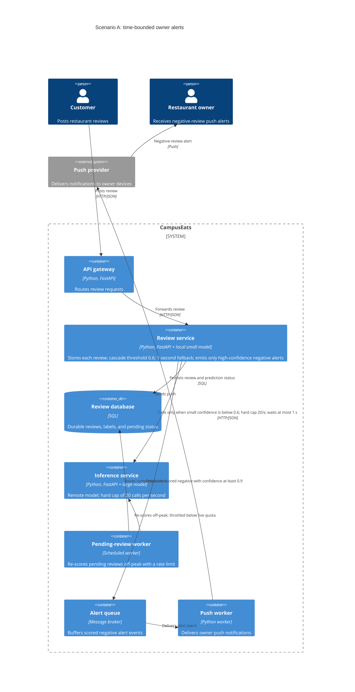

# Task 4: Deployment topologies and trade-offs

**Name / ชื่อ:** Chayakorn Chaiyaphan

**Student ID / รหัสนิสิต:** 6632038021

This is **individual work**: each student completes and submits their own copy, in their own fork.

*งานนี้เป็น**งานเดี่ยว** นิสิตแต่ละคนทำและส่งงานของตัวเอง ใน fork ของตัวเอง*

**Scenario (A, B or C) / Scenario ที่เลือก:** A — Owner alerts

Choose **one** scenario below. If the last digit of your student ID is odd, take A or B; if it is even, take B or C. Use your measurements from Tutorial 6 as evidence: cite run names from `results/runs.csv`. Answer in Thai or English.

เลือก scenario **หนึ่ง** ข้อด้านล่าง ถ้าเลขตัวสุดท้ายของรหัสนิสิตเป็นเลขคี่ ให้เลือก A หรือ B ถ้าเป็นเลขคู่ ให้เลือก B หรือ C ใช้ผลการวัดจาก tutorial ที่ทำไปเป็นข้อมูลอ้างอิง โดยอ้างชื่อ run จาก `results/runs.csv` จะตอบเป็นภาษาไทยหรือภาษาอังกฤษก็ได้

Facts that hold in every scenario / ข้อเท็จจริงที่ใช้กับทุก scenario:

- The large model serves at most **20 calls per second** (4 calls at once × about 200 ms each), and every call costs money.

  *large model รับได้สูงสุด **20 calls ต่อวินาที** (พร้อมกัน 4 calls × ประมาณ 200 ms ต่อ call) และทุก call มีค่าใช้จ่าย*
- The small model is fast and cheap enough to run anywhere, including inside the review service or on a kiosk, but it is much less accurate on its own.

  *small model เร็วและถูกพอที่จะรันที่ไหนก็ได้ รวมถึงภายใน review service หรือบน kiosk แต่ถ้าใช้ตัวเดียวจะแม่นน้อยกว่ามาก*

## Scenarios

**A. Owner alerts.** When a customer posts a negative review, the restaurant owner gets a push notification within **2 seconds**. At the lunch peak, CampusEats receives **40 reviews per second**. A missed alert is acceptable, but a wrong alert (for example, "your customer is unhappy" when they are happy) makes owners stop trusting alerts and, in the end, ignore them.

*เมื่อลูกค้าโพสต์รีวิวเชิงลบ เจ้าของร้านจะต้องได้รับ push notification ภายใน **2 วินาที** เวลาช่วงพีคตอนเที่ยง CampusEats ได้รับรีวิวจำนวน **40 รายการต่อวินาที** การพลาด alert ไปบ้างนั้นยอมรับได้ แต่ alert ที่ผิด (เช่น "ลูกค้าไม่พอใจ" ทั้งที่จริงๆ แล้วพอใจ) จะทำให้เจ้าของร้านไม่เชื่อถือและเลิกสนใจ alert ในที่สุด*

**B. Canteen kiosk.** A tablet in each canteen lets students leave a review on the spot. However, the canteen Wi-Fi is poor: the tablets lose their connection several times a day, for minutes at a time. The system must accept every review, even while a tablet is offline. Restaurant owners need the labels **by the end of the day**.

*มี tablet ในแต่ละโรงอาหารให้นิสิตรีวิวได้ทันที อย่างไรก็ดี การเชื่อมต่อ Wi-Fi ในโรงอาหารไม่ดี ทำให้ tablet หลุดการเชื่อมต่อวันละหลายครั้ง ครั้งละหลายนาที ระบบจะต้องรับรีวิวได้ทุกรายการแม้ขณะที่กำลัง offline อยู่ และเจ้าของร้านต้องการ label **ภายในสิ้นวัน***

**C. Weekly report.** Restaurant owners want a weekly sentiment report. Nothing in producing this report has to be real-time. **Accuracy matters most** and **cost must be minimal**.

*เจ้าของร้านต้องการรายงาน sentiment รายสัปดาห์ ไม่มีอะไรที่จะต้องทำแบบ real-time ในการออกรายงานนี้ ความแม่นยำ **(accuracy) สำคัญที่สุด** และ **ค่าใช้จ่ายต้องน้อยที่สุด***

## Topologies and patterns to choose from / Topology และ pattern ที่เลือกใช้ได้

| | Topology | Where the model runs / โมเดลรันที่ไหน |
|---|---|---|
| T1 | Model as a service, synchronous | Inference service, called for each review (today's baseline) *inference service ถูกเรียกทุกรีวิว (baseline ของวันนี้)* |
| T2 | Model as a library | Inside the review service, or on the device *ภายใน review service หรือบนอุปกรณ์* |
| T3 | Hybrid | Small model locally, large model as a remote service *small model รันในเครื่อง large model เป็น remote service* |
| T4 | Asynchronous / batch | Reviews are queued (broker, W10) or stored, and scored later in bulk *รีวิวถูกเข้าคิว (broker, W10) หรือเก็บไว้ แล้วติด label ทีหลังเป็นชุด* |

Combine one topology with any of the patterns from Tutorial 6: **fallback**, **cascade** and **cache**.

*เลือก topology หนึ่งแบบ แล้วผสมกับ pattern จาก Tutorial 6 ได้ตามต้องการ: **fallback**, **cascade** และ **cache***

## 1. Quality requirements

The three most important quality requirements for your scenario, each with a number where possible.

*quality requirements ที่สำคัญที่สุด 3 ข้อของ scenario ที่เลือก ระบุตัวเลขเมื่อทำได้*

| # | Quality | Requirement |
|---|---|---|
| 1 | Performance | At the 40-reviews/second peak, at least 95% of high-confidence negative alerts we send should reach the owner within 2 seconds. |
| 2 | Accuracy and trust | Keep accuracy at 90% or higher for scored reviews. Aim for at least 95% precision on push alerts; do not send alerts for pending or uncertain predictions. |
| 3 | Capacity and cost | Keep large-model traffic at or below 20 calls/second. If capacity is full, save the review as pending and process it off-peak. |

## 2. Design / การออกแบบ

Your topology, the patterns you add, and a container-level diagram (C4 level 2). The C4 diagram must be written in Mermaid.

*topology ที่เลือก pattern ที่เพิ่ม และ diagram ระดับ container (C4 level 2) เขียนด้วย Mermaid*

**Topology:** T3 Hybrid. Run the small model inside the Review service and call the remote large model only when small-model confidence is below 0.6. Save each review first. If a call times out, errors, or hits the quota, keep the review as pending and do not send a push. Cap large-model traffic at 20 calls/second. Send pushes only for scored negative predictions with confidence of at least 0.9; a batch worker can re-score pending reviews off-peak.

I also checked the rules on the 500 reviews in `data/test.csv`. The 0.6 cascade reached 90.6% accuracy and sent 49.6% of reviews to the large model, or about 19.8 calls/second at peak—almost the full quota. The 0.9 alert gate produced 169 negative alerts with 95.3% precision and 60.3% recall. This was a separate held-out check, not a load test, so it should be checked again with production-like traffic.

The diagram shows the prediction path, pending-review storage, and push-notification flow.

## 3. Evidence / หลักฐาน

Which runs support your choice? Show the numbers and, for scenario A, the capacity arithmetic: how many large-model calls per second does your design need at the peak?

*run ไหนที่สนับสนุนการตัดสินใจของนิสิต ให้นิสิตแสดงตัวเลขประกอบ และสำหรับ scenario A ให้นิสิตแสดงการคำนวณ capacity ด้วย เพื่อแสดงว่าในช่วงพีคนั้น design ของนิสิตต้องใช้ large model กี่ calls ต่อวินาที*

| Run | What it shows / แสดงอะไร |
|---|---|
| t0-large | 93.5% accuracy, 603 ms p95, and 100% large calls. At 40 reviews/s that would mean 40 large calls/s, twice the limit. |
| t0-small | 72.5% accuracy and no large calls; fast and cheap, but below the 90% target. |
| t2-0.6 | 91.5% accuracy, 623 ms p95, and 38% large calls. At peak: 40 × 0.38 = 15.2 large calls/s. |
| t2-0.7 | 53% large calls, or 21.2 calls/s at peak; over the limit. |
| t2-0.8 | 64% large calls, or 25.6 calls/s at peak; over the limit. |
| t2-0.9 | 77% large calls, or 30.8 calls/s at peak; over the limit. |
| t1-after | With the 10% hang test, there were 0 errors and 25 pending reviews. Fallback kept review posts from failing. |

## 4. ADR

Use the ADR format from W5.

*ใช้รูปแบบ ADR จาก W5*

**Title:** Hybrid cascade for owner alerts

**Status:** Proposed

**Context:** CampusEats gets 40 reviews per second at lunch, and owners need negative-review alerts within 2 seconds. The large model can handle only 20 calls per second. A wrong alert harms trust, while a missed alert is acceptable. `t0-large` sends every review to the large model; `t0-small` is only 72.5% accurate. Of the tested cascade thresholds, 0.6 is the only one that stays within the large-model limit for the measured load-test mix.

**Decision:** Use T3 Hybrid. Run the small model in the Review service and call the remote large model when confidence is below 0.6. Save reviews before scoring; on timeout, error, or a full quota, mark the review pending and do not push an alert. Send a push only for a scored negative result with confidence of at least 0.9. Re-score pending reviews off-peak, with a limit on batch calls.

**Consequences:**
- Positive: At the `t2-0.6` mix, peak demand is about 15.2 large calls/s, and measured accuracy was 91.5%. The separate alert-gate check had 95.3% precision; skipping uncertain alerts helps avoid false alarms.
- Negative: If many reviews are difficult, demand can hit the cap and some reviews will stay pending, which means missing those real-time alerts. The load test used concurrency 10 and did not include push delivery. The gate also missed 39.7% of actual negative reviews in the held-out check, so the full flow needs testing at production-like load.

**Alternatives considered:** at least one topology you rejected, and why.

*อย่างน้อยหนึ่ง topology ที่ไม่เลือก และเหตุผล*

- **T1, synchronous large model for every review:** This would need 40 calls/s at peak, above the 20-call limit; `t0-large` sent every review to the large model.
- **T2, small model only:** `t0-small` reached only 72.5% accuracy, below the 90% target, so it could produce too many wrong alerts.
- **T4, batch-only scoring:** Scoring later cannot meet the 2-second alert deadline. Batch is used only to recover pending reviews off-peak.
